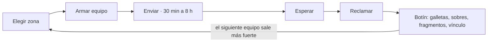

# Expediciones · Waifu Baker

16 de octubre de 2026

## Resumen

Las Expediciones le dan un trabajo a cada carta: el jugador manda de 1 a 3 waifus a explorar una zona y vuelven horas después con galletas, fragmentos de mapa, sobres y vínculo. La colección deja de ser solo un álbum y hay razón para entrar a la app dos o tres veces al día.

Usa lo que Waifu Baker ya tiene: colecciones, rarezas, holo, galletas, sobres, el panel de Personajes y las probabilidades públicas. No necesita intercambio entre jugadores, así que respeta los términos actuales (cartas sin valor monetario y no intercambiables).

Qué resuelve:

- **Cartas comunes y repetidas sin uso.** Todas sirven según su terreno y su rol, no solo las raras.
- **Nada que hacer entre sobres gratis.** Expediciones cortas y largas que terminan a distintas horas.
- **Poco apego a las personajes.** El vínculo desbloquea diálogos y marcos que solo se ganan usándolas.

## El ciclo de juego



El jugador elige una zona del mapa, arma un equipo de hasta 3 cartas viendo la calificación esperada, elige la duración y las manda. Mientras están fuera, esas cartas no se pueden usar. Al volver, el reporte entrega botín que alimenta la siguiente vuelta: más cartas, más zonas y más poder.

## Rasgos de las cartas

Cada carta tiene cuatro datos para explorar: **poder** (sale de la rareza), **terreno**, **rol** y **nivel**. El terreno y el rol se definen una vez por personaje en el panel de Personajes, así todas las cartas de una misma personaje los comparten. Ejemplo: Yuki es terreno **Ciudad** y rol **Guardiana**.

La regla de diseño: el terreno correcto pesa más que la rareza. Una Común en su terreno (10 × 1.5 = 15) rinde más que una Rara fuera de él (14). Así ninguna carta sobra.

| Rareza | Poder base |
| --- | --- |
| Común | 10 |
| Rara | 14 |
| Épica | 20 |
| SSR | 28 |

Ajustes al poder: holo ×1.15, y cada nivel de carta +5% (hasta nivel 5, con duplicados; ver Vínculo y duplicados). Los nombres de rareza son los de ejemplo; se mapean a los que ya usa la app.

**Terrenos (5 para empezar):** Ciudad, Bosque, Costa, Ruinas, Montaña.

| Rol | Qué mejora | Cómo se nota en el reporte |
| --- | --- | --- |
| Recolectora | +30% galletas y materiales | Más cantidad en el botín |
| Buscatesoros | ×1.5 la probabilidad de botín raro | Sobres y cartas de zona salen más |
| Cartógrafa | ×2 fragmentos de mapa | Se desbloquean zonas antes |
| Guardiana | −50% probabilidad de eventos malos | Menos tormentas y extravíos |
| Carismática | Eventos de personajes y comerciantes más frecuentes | Regalos y descuentos en el reporte |

El rol no cambia qué tan bien salió la expedición, sino **qué** se trae. Eso separa dos decisiones: qué tan fuerte es el equipo y qué botín busca el jugador.

## Zonas y mapa

El mapa empieza con 2 zonas abiertas y 4 cubiertas de niebla. Las zonas se abren en orden con **fragmentos de mapa**, que solo salen de expediciones. Cada zona tiene una **carta exclusiva** que no sale en sobres: juntas forman la colección *Expedición · Vol. 1* (6 cartas), que se ve en el álbum como cualquier otra.

| Zona | Terreno | Dificultad | Se abre con | Carta exclusiva |
| --- | --- | --- | --- | --- |
| Calles de Puerto Miel | Ciudad | 30 | Desde el inicio | Rara |
| Bosque de los Susurros | Bosque | 30 | Desde el inicio | Rara |
| Costa Coral | Costa | 55 | 5 fragmentos | Rara |
| Ruinas de Velmora | Ruinas | 80 | 10 fragmentos | Épica |
| Paso de la Escarcha | Montaña | 110 | 15 fragmentos | Épica |
| Cámara Sellada | Ruinas | 150 | 25 fragmentos | SSR |

Para dar escala a la dificultad: 3 Comunes en su terreno suman 45; 3 SSR en su terreno, 126. La Cámara Sellada pide un equipo bien armado y con vínculo, no solo cartas caras.

Los nombres y la cantidad de zonas son una propuesta; lo importante es la curva. Agregar una zona nueva más adelante es solo cargar una fila en el panel (ver Panel de administración).

## Cómo se calcula el resultado

El resultado sale de comparar el poder del equipo con la dificultad de la zona. El jugador ve la calificación esperada **antes** de mandar el equipo, así la decisión es suya y no una sorpresa.

Poder de cada carta:

```latex
P_{carta} = base_{rareza} \times T \times H \times (1 + 0.05 \cdot nivel) \times (1 + 0.02 \cdot v\acute{\imath}nculo)
```

T = 1.5 si el terreno coincide con la zona, si no 1. H = 1.15 si es holo, si no 1.

Poder del equipo y proporción:

```latex
P_{equipo} = \left(\sum P_{carta}\right) \times (1 + sinergia) \qquad r = \frac{P_{equipo}}{dificultad}
```

Sinergias (se suman): +10% si las tres cartas tienen roles distintos; +10% si dos personajes están marcadas como dúo en el panel (hermanas, rivales, compañeras).

| r | Calificación | Botín |
| --- | --- | --- |
| 1.4 o más | Excelente | 125% |
| 1.0 a 1.39 | Bien | 100% |
| 0.6 a 0.99 | Normal | 80% |
| menos de 0.6 | Difícil | 50% |

El tope de 125% evita que convenga mandar siempre SSR a zonas fáciles: el botín de esas zonas es menor y pasar de Excelente no da más.

**Ejemplo con Yuki** (SSR, Ciudad, Guardiana, sin nivel ni vínculo), junto a una Común de Ciudad y una Rara de Bosque con roles distintos:

| Zona | Cálculo | r | Resultado |
| --- | --- | --- | --- |
| Calles de Puerto Miel (30) | (42 + 15 + 14) × 1.1 = 78.1 | 2.6 | Excelente |
| Ruinas de Velmora (80) | (28 + 10 + 14) × 1.1 = 57.2 | 0.72 | Normal |

El mismo equipo pasa de Excelente a Normal solo por el terreno. Para las Ruinas conviene armar otro equipo, aunque tenga cartas de menor rareza.

## Botín y economía

Cada expedición hace un número de **tiradas** según su duración; cada tirada saca un premio de la tabla de la zona. La calificación multiplica las tiradas (3 tiradas × 80% = 2 seguras y 40% de probabilidad de una tercera). Las tablas se publican en la página de Probabilidades, igual que los sobres.

| Duración | Tiradas | Tiradas por hora | Galletas esperadas\* | Sobres esperados\* |
| --- | --- | --- | --- | --- |
| 30 min | 1 | 2 | 7 | 0.02 |
| 2 h | 3 | 1.5 | 21 | 0.06 |
| 8 h | 9 | 1.1 | 64 | 0.18 |

\*Con calificación Bien en Ruinas de Velmora. Las cortas rinden más por hora para premiar al que entra seguido; las largas son para dejar de noche.

**Tabla de ejemplo: Ruinas de Velmora, por tirada**

| Premio | Probabilidad | Cantidad |
| --- | --- | --- |
| Galletas | 62% | 8 a 15 |
| Fragmento de mapa | 25% | 1 |
| Nada (solo un evento en el reporte) | 10% | — |
| Sobre de la colección activa | 2% | 1 |
| Carta exclusiva de la zona | 1% | 1 |

La Buscatesoros multiplica ×1.5 las dos últimas filas y lo descuenta de las galletas, para que las probabilidades sigan sumando 100%.

**Espacios de expedición:** 2 al empezar, el 3.º al completar 10 expediciones y el 4.º al abrir la Cámara Sellada.

**Presupuesto:** con 2 espacios, un jugador activo hace unas 30 tiradas al día: unas 200 galletas, 7 fragmentos y medio sobre. El precio del sobre en galletas define si eso es mucho o poco (ver Decisiones pendientes). Abrir todo el mapa pide 55 fragmentos, unos 8 a 10 días de juego activo.

No hay forma de pagar para acelerar una expedición en esta versión. Si después se agrega, que sea con galletas y nunca con dinero real.

## Eventos y reporte

El reporte cuenta qué pasó con frases cortas entre las personajes. Es lo que más engancha y lo más barato de producir: son plantillas de texto con huecos para los nombres. Una expedición de 30 min tiene 1 evento, la de 2 h tiene 2 y la de 8 h tiene 3.

| Tipo | Probabilidad base | Efecto | Plantilla de ejemplo |
| --- | --- | --- | --- |
| Escena | 45% | Ninguno | {A} y {B} discutieron qué pasillo tomar. {B} tenía razón. |
| Bueno | 30% | +1 tirada | {A} encontró un cofre detrás de una pared falsa. |
| Malo | 20% | −1 tirada (mínimo 1) | Una tormenta en {zona} los obligó a volver antes. |
| Encuentro | 5% | +10 a 30 galletas | Un comerciante le regaló algo a {A} por su sonrisa. |

Los roles cambian las probabilidades: la Guardiana reduce los malos a la mitad y la Carismática duplica los encuentros. Una plantilla puede pedir un rol y entonces usa a esa carta: *{Guardiana} vio la trampa a tiempo. Nadie salió herido.*

Las parejas marcadas como dúo en el panel tienen escenas propias, con diálogo escrito para ellas. Para el lanzamiento bastan unas 40 plantillas generales y 5 por zona.

**Ejemplo de reporte**

> **Calles de Puerto Miel · 2 h · Excelente** Yuki, Mika y Sora
>
> Yuki detuvo a un carterista antes de que se escapara con la bolsa de Sora. Mika y Sora se perdieron buscando una panadería. Yuki las encontró.
>
> Botín: 34 galletas, 2 fragmentos de mapa Vínculo: Yuki +12, Mika +12, Sora +12

Mika y Sora son nombres de ejemplo para las otras dos cartas.

## Vínculo y duplicados

**Vínculo** es por personaje, no por carta: todas las cartas de Yuki suman al mismo vínculo. Cada expedición da experiencia a las tres: 4 por una de 30 min, 12 por una de 2 h y 30 por una de 8 h. Cada nivel suma además +2% de poder en expediciones.

| Nivel | Experiencia acumulada | Recompensa |
| --- | --- | --- |
| 2 | 50 | Frase de presentación en su ficha |
| 3 | 150 | Escenas propias en los reportes |
| 5 | 500 | Diálogo especial al abrir su ficha |
| 7 | 1000 | Marco de vínculo con su color, para todas sus cartas |
| 10 | 2500 | Fondo alterno para su carta por capas |

Un jugador que la usa a diario (unos 80 puntos al día) llega a nivel 10 en un mes. El fondo alterno aprovecha el visor por capas: es solo cambiar la capa 1.

**Duplicados.** Como las cartas no se intercambian, las copias repetidas necesitan una salida:

- **Entrenar:** gastar 1 copia repetida de la misma carta sube su nivel en 1 (+5% de poder). Tope: nivel 5, o sea 5 copias.
- **Después del nivel 5:** cada copia extra se convierte en 1 fragmento de mapa o en galletas (el equipo elige; ver Decisiones pendientes).
- La versión holo es otra variante: tiene su propio nivel y no consume copias normales.

Una carta que está en una expedición no puede entrenarse ni ir a otra al mismo tiempo.

## Pantallas

Un nuevo apartado **Expediciones** en el menú, dentro de Colección, con un contador rojo como el de Recompensas cuando hay equipos de vuelta.

1. **Mapa.** Las zonas como puntos sobre un mapa ilustrado. Abiertas, en curso (con su temporizador) o con niebla (con los fragmentos que faltan, por ejemplo 7 / 10).
2. **Preparar expedición.** Arriba la zona con su terreno y dificultad. Abajo 3 espacios y el selector de cartas, que muestra primero las del terreno correcto y filtra por terreno, rol y rareza. Una barra compara el poder del equipo con la dificultad y dice la calificación esperada en vivo. Luego se elige la duración y se toca **Enviar · 2 h**.
3. **En curso.** Una tarjeta por espacio con las tres cartas y el tiempo que falta. Cancelar devuelve las cartas sin botín, con una confirmación antes.
4. **Reporte.** Al reclamar, las cartas vuelven una por una, los eventos aparecen línea por línea, luego cae el botín y suben las barras de vínculo. Si salió una carta exclusiva, se revela con el mismo volteo de la apertura de sobres.
5. **Ficha de carta.** Suma terreno, rol, nivel, vínculo de la personaje y, si está fuera, *En expedición hasta las 18:40*.

En móvil el selector de cartas sube como hoja desde abajo y el resto es igual, apilado en una columna.

## Panel de administración

Todo lo que define el balance vive en el panel, no en el código, para poder ajustar sin publicar una versión nueva.

| Sección | Qué se agrega |
| --- | --- |
| Personajes | Terreno, rol y "dúo con" (otra personaje) |
| Zonas (nueva) | Nombre, terreno, dificultad, fragmentos para abrir, orden en el mapa, ilustración, carta exclusiva, activa sí/no |
| Botín de zona (nueva) | Premios con peso y cantidad mínima y máxima. Avisa si las probabilidades no suman 100%, como ya hace con los sobres |
| Eventos (nueva) | Plantillas con tipo, zona (o todas), rol o dúo requerido y texto con huecos. Vista previa con cartas reales |
| Simulador de expediciones (nueva) | Zona, equipo y duración; corre 10,000 expediciones y muestra calificación, botín promedio y galletas por día con 2 espacios |
| Ajustes | Duraciones y tiradas, porcentaje de botín por calificación, cantidad de espacios |

El simulador es la pieza clave para el balance. Antes de abrir una zona nueva, se prueba con un equipo de Comunes, uno mixto y uno de SSR, y se revisa que la curva tenga sentido.

## Implementación técnica

El servidor decide todo y el navegador solo muestra. Así nadie puede cambiar el resultado desde el cliente ni adelantar el reloj del teléfono.

**Modelo de datos**

```
personaje         + terreno, rol, duo_id
zona              id, nombre, terreno, dificultad, fragmentos_req, orden,
                  carta_exclusiva_id, imagen, activa
zona_botin        id, zona_id, tipo (galletas | fragmento | sobre | carta),
                  item_id, peso, min, max
evento_plantilla  id, tipo, zona_id?, rol_req?, solo_duo, texto, efecto
expedicion        id, usuario_id, zona_id, duracion_min, inicia_en, termina_en,
                  semilla, poder, calificacion,
                  estado (en_curso | reclamada | cancelada), resultado_json
expedicion_carta  expedicion_id, carta_id, variante (normal | holo), posicion
vinculo           usuario_id, personaje_id, xp, nivel
carta_nivel       usuario_id, carta_id, variante, nivel
usuario           + fragmentos, espacios
zona_abierta      usuario_id, zona_id, abierta_en
```

**API**

| Método | Ruta | Qué hace |
| --- | --- | --- |
| GET | /api/expediciones/zonas | Zonas con su estado para este usuario |
| GET | /api/expediciones | Expediciones en curso y listas para reclamar |
| POST | /api/expediciones/previa | Calcula poder y calificación de un equipo sin enviarlo |
| POST | /api/expediciones | Envía: zona, duración y cartas |
| POST | /api/expediciones/:id/reclamar | Tira el botín y lo entrega |
| POST | /api/expediciones/:id/cancelar | Devuelve las cartas sin botín |
| POST | /api/zonas/:id/abrir | Gasta fragmentos y abre la zona |
| GET | /api/probabilidades/expediciones | Tablas públicas de botín |

**Reglas del servidor**

- **Al enviar:** valida que el usuario tenga las cartas, que ninguna esté en otra expedición, que la zona esté abierta y que haya espacio libre. Guarda el poder, la calificación y una semilla aleatoria. `termina_en` usa la hora del servidor.
- **Una carta, una expedición:** una carta (por variante) solo puede estar en una expedición a la vez, aunque el jugador tenga varias copias.
- **El poder se congela al enviar:** si después entrenan la carta, esa expedición no cambia.
- **Al reclamar:** solo si ya pasó `termina_en`. Las tiradas y eventos salen de la semilla, así un mismo envío siempre da el mismo resultado (útil para soporte y para el simulador). Botín, vínculo y estado se guardan en una sola transacción.
- **Reclamar dos veces** devuelve el resultado ya guardado, sin entregar nada de nuevo.
- **"Lista para reclamar"** se calcula con la hora; no hace falta una tarea programada.

Para el reporte y la carta exclusiva, el front reutiliza `carta-capas.js` del paquete de la carta por capas.

## Fases y métricas

Conviene lanzar una versión pequeña, medir si se vuelve hábito y después sumar contenido.

**Fase 1 · Lanzamiento**

- 4 zonas: 2 abiertas y 2 con niebla
- Terreno y rol en Personajes; poder, calificación y vista previa antes de enviar
- 3 duraciones; botín de galletas, fragmentos y sobres
- 20 plantillas de escena, sin eventos por rol
- Vínculo con niveles (solo el +2% de poder por ahora)
- Panel: Zonas, Botín de zona y Simulador

**Pasa a fase 2 si** al menos 40% de los usuarios activos manda una expedición al día durante 2 semanas.

**Fase 2 · Profundidad**

- Las 6 zonas y la colección *Expedición · Vol. 1*
- Entrenar con duplicados
- Recompensas de vínculo: frase, marco y fondo alterno
- Dúos, escenas propias y eventos por rol; editor de Eventos en el panel

**Fase 3 · Temporadas**

- Zonas temporales con su carta exclusiva
- Zona de la semana con bonus para un terreno
- Expedición comunitaria: todos aportan poder a una meta común y, si se llega, todos reciben premio

**Qué medir** (las metas son un punto de partida)

| Métrica | Pregunta que responde | Meta |
| --- | --- | --- |
| Usuarios activos que mandan al menos 1 expedición al día | ¿Se volvió hábito? | 40% |
| Expediciones por usuario activo al día | ¿Cada cuánto vuelven? | 3 |
| Cartas de la colección usadas al menos una vez | ¿Sirven las comunes? | 60% |
| Expediciones con calificación Bien o Excelente | ¿La dificultad está bien puesta? | 60 a 75% |
| Galletas ganadas contra gastadas por día | ¿Hay inflación? | Ganadas menor que gastadas |
| Retención al día 7, antes y después | ¿Valió la pena? | Que suba |

## Decisiones pendientes

- [ ] **Precio del sobre en galletas.** Define cuántas galletas da el botín; la tabla de este documento supone unas 200 al día para un jugador activo.
- [ ] **¿Los tiers de Patreon dan un espacio extra?** Recomendación: como mucho uno, como comodidad. Más espacios pagados se sienten como pagar para avanzar.
- [ ] **¿El holo da +15% de poder o es solo estético?**
- [ ] **Copias después del nivel 5:** ¿se convierten en fragmentos o en galletas?
- [ ] **Rarezas reales de la app** y su poder base.
- [ ] **Terreno y rol de cada personaje actual**, cargados en el panel.
- [ ] **Plantillas de eventos en inglés y español**, porque la app tiene los dos idiomas. Falta decidir quién las escribe.
- [ ] **Ilustración del mapa** y una imagen por zona.
